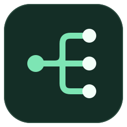

<p align="center"></p>

# Codex 工作台 · Codex Workbench

在一个本地界面里查看多台电脑的 Codex 会话、生成进度、未读状态与任务分叉。

**独立社区项目，非 OpenAI 官方产品。** 这是本机网页应用：后台只监听 `127.0.0.1`，Windows 使用独立浏览器窗口打开。便携包内置 Node.js，无需安装开发环境；不会把你的会话上传到本项目或 GitHub。

## 下载即用

| 系统 | 下载 | 启动 |
| --- | --- | --- |
| Windows 10/11 x64 | [下载 Windows 便携包](https://github.com/Anonnyyy/codex-workbench/releases/latest/download/codex-workbench-win-x64.zip) | 完整解压后双击 `Start-Workbench.cmd` |
| Linux x64 | [下载 Linux 便携包](https://github.com/Anonnyyy/codex-workbench/releases/latest/download/codex-workbench-linux-x64.tar.gz) | 解压后运行 `./Start-Workbench.sh` |

[所有版本与 SHA-256 校验文件](https://github.com/Anonnyyy/codex-workbench/releases)

1. **解压到可写的固定目录**，不要在压缩包内直接运行。
2. 启动后打开 `http://127.0.0.1:24319`。Windows 可双击 `Create-Desktop-Shortcut.cmd` 创建桌面快捷方式。
3. 默认读取当前用户的 `~/.codex`。本机需已有 Codex 会话；没有本机会话也可通过“添加设备”连接远程电脑。

Linux 需要 glibc 2.28+；其他架构可以通过下方源码方式运行。首版便携包未签名，系统可能显示未知发布者。关闭窗口不会停止后台同步；目前没有托盘或自动更新程序。

## 可以做什么

- 按 **设备 → 项目文件夹 → 会话 → 分叉** 展开、折叠；正在工作的项目优先。
- 查看生成中、已完成、需要处理、中断等状态；用红点提示未读。
- 自建文件夹，拖动归类，手动关联主任务与分叉；仅整理工作台，不移动磁盘文件。
- 自动把 VS Code 附带的 `# Context from my IDE setup` 标题压缩为请求摘要；任务详情中可重命名，留空即可恢复自动标题。
- 在时间线中查看所有设备的最近会话，调节项目和时间线的展示数量。
- 手动标记已读／未读，或将已完成会话批量标为已读，保留生成中的未读。
- 使用 SSH 连接 Linux，或用采集端连接可信局域网内的 Windows/Linux 设备。

## 连接其他设备

### Linux：SSH 直连

点击“添加设备 → SSH 直连”，填写名称、地址、端口、用户名与密码。远端需有 **Python 3** 和该用户的 Codex 会话。

通过 SSH 在内存中运行采集器，每约 3 秒同步一次；不安装远端服务。密码只存在于当前进程内，重启或断线后需重新输入；设备配置会保留。

在设备设置中可开启“容量错误自动重试”（现有 5090 设备默认开启）。检测到任务结束时的 `server_overloaded` / `Selected model is at capacity` 后，优先调用原 Codex 窗口的重试操作；窗口未接管任务时，使用与原会话相同版本的 Codex 后台继续原任务。每次检测到容量错误后立即自动重试，不增加等待时间，持续到正常完成；连接暂不可用时在下一次状态同步继续检查，各任务独立重试。过程不弹出通知，正常完成或等待你回答时，通过 Edge 显示 Windows 系统通知，包含设备名（如 5090、本机）、任务工作目录的文件夹名、任务标题和状态；不再显示自绘浮窗或网页提醒卡片。系统提醒需允许浏览器通知权限。侧栏可随时开启或关闭；关闭后收起已有通知，刷新或重新打开也保持关闭，重新开启只提醒之后的新进展；打开工作台或原生已读同步确认后，会关闭对应回复的系统通知。请保持工作台后台及 SSH 连接运行。

只处理开启时最近 5 分钟及之后的新容量错误；其他错误、手动中断、审批等待和内部子任务不会自动重试。重试前会重新检查原回合。同一失败回合只提交一次；回执丢失时等待状态确认，避免重复执行。后台恢复沿用原任务的模型、推理强度、工作目录和权限设置；找不到匹配的 Codex 版本时保留任务，等待连接恢复。

任务列表、最近会话和任务详情显示容量错误后的累计重试尝试次数。次数写入本机 `.workbench/state.json`，任务完成、关闭自动重试或重启工作台后仍保留。任务详情保存最近 20 次尝试的时间及结果，包括已触发、连接不可用、取消和回执待确认；连接不可用的尝试也计数。升级时保留旧版仍可读取的次数，旧版未保存的逐次结果不补造。

### 待发送消息

首页右上角的“消息队列”可查看所有已保存的待发送消息。即使设备离线或工作台刚重启，也能看到已保存内容；重新连接设备后可编辑和继续发送。

打开 SSH 设备上的任务，在右侧“待发送消息”中添加下一步要求。每个对话最多缓存 3 条未完成消息（含正在发送或执行的一条），每条最多 8000 字符；待发送条目可以编辑、删除、上下移动或暂停整个队列。当前回合明确正常完成后才发送第一条，之后逐条等待正常完成；容量错误、审批等待、其他失败及手动中断都不会跳到下一条。已正常完成的任务加入队列后会自动发送。

队列保存在本机 `.workbench/state.json`，后台持续运行即可调度；重启后重新连接 SSH 会恢复检查。发送通过原对话执行并沿用其设置，优先使用原窗口，窗口不可用时尝试原 Codex 后台。发送前再次检查回合状态，发送前保存占用状态；回执不确定时只核对原记录，不重复提交，未能确认时后续队列保持等待。队列未全部完成时不弹出完成通知；最后一条正常完成后按现有通知设置提醒。最近 20 条完成消息保留在队列历史中。

首次连接优先检查 `~/.ssh/known_hosts` 中的明文主机项；未知主机采用首次信任并保存 SHA-256 指纹，后续密钥变化会拒绝连接。当前不支持 hashed known_hosts 和密钥登录。

### Windows/Linux：采集端

在目标电脑解压同样的便携包，从包目录运行：

```powershell
# Windows PowerShell
.\runtime\node.exe server/agent.mjs
```

```sh
# Linux
./runtime/node server/agent.mjs
```

默认端口 `4311`，首次生成 `.workbench/agent-token`。在工作台“添加设备 → 采集端”填入 `http://设备IP:4311` 和该文件中的密钥。此模式使用明文 HTTP，仅用于可信局域网；跨网络请使用 SSH 或安全隧道，不要直接开放公网端口。

## 已读同步的边界

- 打开工作台详情，会把当前展示的回复标为已读；新回复仍会产生未读。
- 本机 Codex 桌面端：读取已知 v1 格式的原生已读记录，仅匹配明确的账号、主机和任务。
- VS Code（包括 SSH 任务）：同时被动监听本机界面与 SSH 端的 Codex IPC v3 已读事件。Windows 的共享界面记录按唯一任务 ID 匹配设备，不把界面中的 `local` 当成物理本机；重复 ID 不自动匹配。已保存的状态补齐初始已读，后续只接受任务本身的阅读事件或活动记录。
- IPC 断开期间的事件可能遗漏；未知客户端版本不猜测。可在工作台手动修正。
- 手动未读只针对当时的那条回复。生成中的会话不会被批量清理或原生已读快照自动清除。

## 数据与升级

会话采集是只读的。设备地址、文件夹、已读回执等保存在解压目录下的 `.workbench/`，**不要把这个目录分享给别人**。网页布局偏好保存在浏览器中。

升级时先停止工作台后台进程，完整备份 `.workbench/`；解压新版本，再把 `.workbench/` 放到新目录。浏览器界面可能需要刷新。Windows 可以在任务管理器中确认对应 `node.exe` 的命令行为本项目 `server/hub.mjs` 后结束；Linux 可按该命令行确认进程再停止。

| 环境变量 | 用途 |
| --- | --- |
| `CODEX_HOME` | 指定 Codex 数据目录，默认当前用户的 `.codex` |
| `WORKBENCH_DATA` | 指定工作台数据目录 |
| `PORT` | 后台端口，默认 24319（自定义端口时手动启动后台并访问相同端口） |
| `AGENT_HOST` / `AGENT_PORT` | 采集端监听地址／端口，默认 `0.0.0.0:4311` |
| `WORKBENCH_TOKEN` | 采集端配对密钥；省略则自动生成 |

## 准确性与限制

当前每台设备加载最近 300 条未归档会话。状态从 Codex 的 SQLite 与 JSONL 记录推断；超过 2 分钟没有活跃事件会显示“待确认”，不代表任务已完成。离线时仅保留本次运行的最后快照。

是否打开某个项目取决于进程与工作区记录。Linux SSH 可采集进程，本机未提供进程列表时使用生成状态。Remote-SSH 工作区映射需要本机 VS Code 有相应记录，其他电脑打开的窗口可能无法精确关联目录。

除上述可关闭的容量错误重试外，不创建／分叉原生 Codex 会话或终止任务。任务关联只改变工作台的组织关系。

## 从源码运行

需要 Node.js 22.13+（发布包使用 24.21.0）。

```sh
npm ci
npm run build
npm start
```

开发界面可另运行 `npm run dev`。验证：

```sh
npm test
npm run build
```

制作便携包需要 Python 3、npm 与网络连接；只按白名单打包，Node 下载会校验固定 SHA-256：

```sh
python scripts/package_release.py --target win-x64
python scripts/package_release.py --target linux-x64
```

`--output` 可指定新的输出目录。GitHub Actions 会在 Windows 与 Linux 上测试各自的便携包；不会采集真实用户会话作为测试数据。

## License

[MIT](LICENSE)。便携运行时和依赖的许可见 [THIRD-PARTY-NOTICES.md](THIRD-PARTY-NOTICES.md)。
